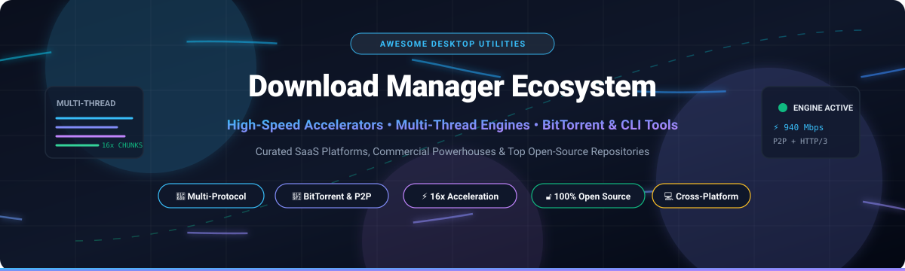

# Awesome-Download-Manager-Desktop-Utilities 🚀

  

  
  
  
  
  
  

---

## ⚡ Top Download Manager & Desktop Utilities Ecosystem

**Curated List of SaaS Products & Open-Source GitHub Projects** 🌐  
*Focused on Multi-Protocol Downloading, BitTorrent Clients & Self-Hosted Transfer Engines* 🧲  
**Last updated: March 2026** 📅

Welcome to the ultimate directory of **download managers**, **download accelerators**, and **file transfer desktop utilities**. Whether you need high-concurrency multi-threaded HTTP/HTTPS segment downloaders, headless daemon transfer engines, resilient BitTorrent/P2P clients, or browser-integrated media scrapers, this curated guide benchmarks commercial SaaS and open-source tools across Linux, macOS, Windows, Docker, and Android.

---

## 📑 Table of Contents
- [📊 Sector Overview & Market Dynamics](#-sector-overview--market-dynamics)
- [💼 SaaS/Commercial Platforms](#-saascommercial-platforms)
- [🔓 Open-Source GitHub Projects](#-open-source-github-projects)
- [🤝 How to Contribute](#-how-to-contribute)
- [💖 Support & Sponsorship](#-support--sponsorship)
- [📈 Star History](#-star-history)
- [⚠️ Disclaimer](#-disclaimer)

---

## 📊 Sector Overview & Market Dynamics

The global download manager and file transfer utilities sector represents a mature niche micro-market estimated at approximately **$250M–$400M** annually (nested within the broader $4.5B SaaS management and software utility ecosystem). The market is **highly fragmented**, characterized by low barriers to entry around standard networking protocols (HTTP/FTP/BitTorrent), strong competition from community-driven open-source alternatives, and independent vendors rather than a consolidated "winner-take-all" cloud monopoly.

---

## 💼 SaaS/Commercial Platforms

| Company / Product | Company Size (Est. Revenue / Valuation) | Pricing (Starting Tier) | Free Tier / Trial Limits |
| :--- | :--- | :--- | :--- |
| **[Folx PRO (Electronic Team)](https://mac.eltima.com/download-manager.html)** | **~$10M–$50M** annual revenue (Electronic Team, Inc. / Eltima) | **$19.95** (one-time single license) or via Setapp ($9.99/mo) | **Free forever plan**: Basic 2-thread splitting, browser integration, auto-resume; limits download scheduling, multi-threading (up to 10 threads), and torrent search to PRO |
| **[Internet Download Manager (Tonec)](https://www.internetdownloadmanager.com/)** | **~$15.1M** annual revenue (est. bootstrapped privately held) | **$11.95/yr** (1-year license, 1 PC) or **$24.95** (lifetime license, 1 PC) | **30-day fully functional free trial**: Unlimited features and acceleration for 30 days; all access blocked upon expiration without purchase |
| **[Seedr (Seedr.cc)](https://www.seedr.cc/)** | **~$2M–$5M** annual revenue (est. bootstrapped indie SaaS) | **$3.95/mo** (Lite tier, 10 GB storage, proxy acceleration) | **Free forever plan**: 2 GB cloud storage limit, 1 active download slot, 480p SD media streaming cap, standard seeding ratio limit (1:1 or 12 hours) |

---

## 🔓 Open-Source GitHub Projects

The following table lists top open-source download accelerators, torrent engines, and CLI utilities, ranked in descending order by GitHub stargazers:

| Repository / Utility | GitHub_Stars | Primary Language / Stack | License | Description & Key Features |
| :--- | :--- | :--- | :--- | :--- |
| **[yt-dlp/yt-dlp](https://github.com/yt-dlp/yt-dlp)** |  | Python | Unlicense | 🎬 Feature-rich command-line audio/video downloader with support for thousands of streaming sites and extractors. |
| **[agalwood/Motrix](https://github.com/agalwood/Motrix)** |  | TypeScript / Electron | MIT | 🎨 Polished modern cross-platform GUI download manager supporting HTTP, FTP, BitTorrent, and Magnet links. |
| **[aria2/aria2](https://github.com/aria2/aria2)** |  | C++ | GPL-2.0 | ⚡ Ultra-fast, lightweight multi-protocol & multi-source command-line download utility with JSON-RPC/XML-RPC remote control. |
| **[qbittorrent/qBittorrent](https://github.com/qbittorrent/qBittorrent)** |  | C++ / Qt | GPL-2.0+ | 🧲 Advanced, open-source BitTorrent client with built-in search engine, sequential downloading, and Web UI. |
| **[GopeedLab/gopeed](https://github.com/GopeedLab/gopeed)** |  | Go / Flutter | GPL-3.0 | 🚀 High-speed multi-platform download manager powered by Golang and Flutter, supporting HTTP, BitTorrent, and custom extensions. |
| **[transmission/transmission](https://github.com/transmission/transmission)** |  | C++ / C | GPL-2.0 / GPL-3.0 | 🛡️ Fast, easy, and lightweight BitTorrent client with native GUI frontends and headless daemon capability. |
| **[alexta69/metube](https://github.com/alexta69/metube)** |  | Python / Angular / Docker | AGPL-3.0 | 🌐 Web GUI for youtube-dl / yt-dlp with playlist support, queueing, and multi-user remote download acceleration. |
| **[subhra74/xdm](https://github.com/subhra74/xdm)** |  | C# / .NET | GPL-3.0 | 🏎️ Xtreme Download Manager (XDM) — Power tool capable of boosting download speeds up to 500%, capturing streaming videos, and browser integration. |
| **[persepolisdm/persepolis](https://github.com/persepolisdm/persepolis)** |  | Python / Qt | GPL-3.0 | 🧭 Elegant GUI frontend for aria2 written in Python, featuring scheduling, video sniffing, and multi-segment downloads. |
| **[mirror/jdownloader](https://github.com/mirror/jdownloader)** |  | Java | GPL | 📦 Community mirror of JDownloader, the extensible automated download manager for file hosters with captcha recognition. |
| **[ugetdm/uget](https://github.com/ugetdm/uget)** |  | C / GTK+ | LGPL-2.1+ | 🐧 Lightweight and native GTK+ download manager for Linux and Windows with multi-connection acceleration and category management. |

---

## 🤝 How to Contribute

Contributions are warmly welcomed! 🌟 To add or improve tools:

1. 🍴 Fork the repository.
2. 🌿 Create a new branch: `git checkout -b feature/add-new-tool`.
3. 📝 Update `README.md` following the established table structure and guidelines.
4. 📬 Submit a Pull Request describing your additions with official links.

---

## 💖 Support & Sponsorship

If you find this curated ecosystem directory helpful, please consider supporting the project! Your encouragement helps keep this resource maintained and up to date:

- ⭐ **Star this repository** to help others discover it.
- 🍴 **Fork and share** with your fellow developers and tech communities.
- ☕ **Buy me a coffee & support my work**: [Sponsor Dashboard on GitHub](https://github.com/sponsors/ishandutta2007)

Thank you so much for your generosity and support! 🙌✨

---

## 📈 Star History

---

## ⚠️ Disclaimer

- This is a **community-curated directory** intended for informational and educational purposes — not an official endorsement.
- Download managers and transfer tools can interact with external URLs and networks; always download from trusted official sources, scan files with security utilities, and adhere to applicable licensing terms and local copyright laws.
- Choose your tool based on your specific operational workflow: GUI simplicity (Motrix, FDM, Gopeed), CLI automation & scripting (aria2, yt-dlp), or dedicated P2P torrent engines (qBittorrent, Transmission).

---

  <b>Built with ❤️ for developers, power users, and data engineering teams worldwide.</b>

